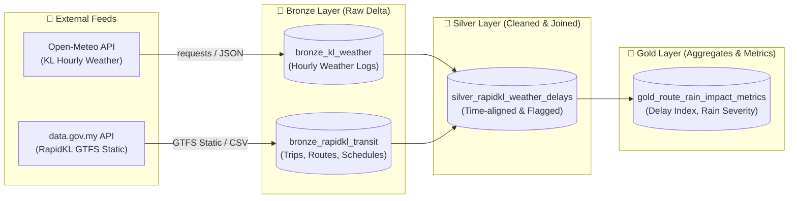

# 🚌🌧️ Klang Valley Transit & Weather Data Pipeline

[](#)
[-00ADD8?logo=apachespark&logoColor=white)](#)
[](#)
[](#)

A production-grade Databricks PySpark pipeline built on the **Medallion Architecture (Delta Lake)** that ingests, cleans, and joins **RapidKL public bus transit feeds** with **Kuala Lumpur meteorological data** to measure route performance and delay metrics during heavy rainfall events.

---

## 🏗️ Architecture & Medallion Pattern



---

## 🎯 Step 1: Bronze Layer (Raw Ingestion)

The **Bronze Layer** ingests raw source feeds with minimal transformations into **Delta Lake**, strictly capturing raw fidelity while appending pipeline audit metadata.

### 1. Kuala Lumpur Weather Feed (`bronze_kl_weather`)
* **Source:** Open-Meteo Historical Archive / Forecast API
* **Coordinates:** Lat `3.1390`, Lon `101.6869` (Kuala Lumpur, Malaysia)
* **Timezone:** `Asia/Kuala_Lumpur` (UTC+8)
* **Variables:** `temperature_2m`, `precipitation` (mm), `rain` (mm), `weather_code`, `relative_humidity_2m`, `wind_speed_10m`
* **Format:** Unpacked from parallel hourly JSON arrays into PySpark DataFrame with timestamp casting and audit fields (`_ingested_at`, `_source_api`).

### 2. RapidKL Bus Transit Feed (`bronze_rapidkl_transit`)
* **Source:** `https://api.data.gov.my/gtfs-static/prasarana?category=rapid-bus-kl`
* **Entities Ingested:**
  - `routes.txt`: Bus route IDs, names, and transit types (~138 routes).
  - `trips.txt`: Scheduled trip identifiers, direction, and shape bindings (~2,098 trips).
  - `stops.txt`: Stop names, unique stop IDs, and coordinates (~4,069 stops).
  - `stop_times.txt`: Scheduled arrival/departure sequences (~88,106 scheduled stop events).
* **Format:** Linked and ingested into Delta Lake table with lineage columns (`_ingested_at`, `_feed_category`, `_source`).

---

## 📁 Repository Structure

```
Klang Valley Transit & Weather Data Pipeline/
├── notebooks/
│   └── 01_bronze_ingestion.py         # Databricks PySpark Ingestion Notebook
├── src/
│   ├── config.py                      # Coordinates, API endpoints, Delta paths
│   ├── utils/
│   │   ├── __init__.py
│   │   └── logger.py                  # Structured logging utility
│   └── ingestion/
│       ├── __init__.py
│       ├── weather_ingestion.py       # Open-Meteo fetch & PySpark parser
│       └── transit_ingestion.py       # data.gov.my GTFS downloader & builder
├── scripts/
│   └── fetch_raw_samples.py           # Local script to fetch & cache raw data samples
├── tests/
│   ├── __init__.py
│   └── test_raw_ingestion.py          # Unit & schema validation tests
├── data/
│   └── raw/                           # Downloaded sample data (JSON & GTFS CSVs)
│       ├── weather/
│       └── gtfs/
├── requirements.txt                   # Pipeline dependencies
├── .gitignore                         # Delta logs, checkpoints, cache ignores
└── README.md                          # Documentation
```

---

## 🚀 How to Run on Databricks Community Edition

### 1. Import the Notebook into Databricks
1. Log in to [Databricks Community Edition](https://community.cloud.databricks.com/).
2. In the sidebar, navigate to **Workspace** -> **Users** -> your username.
3. Click the dropdown arrow next to your workspace folder and select **Import**.
4. Choose **File** and upload [notebooks/01_bronze_ingestion.py](file:///d:/SYAH/Solo%20Project/Klang%20Valley%20Transit%20&%20Weather%20Data%20Pipeline/notebooks/01_bronze_ingestion.py).
   *(Alternatively, link this GitHub repository directly via **Databricks Repos**).*

### 2. Attach Cluster & Run
1. Start your Databricks cluster (Runtime **13.3 LTS** or **14.x** with Spark 3.5+).
2. Open `01_bronze_ingestion`.
3. Adjust widget parameters at the top if desired:
   - `start_date`: e.g., `2024-01-01`
   - `end_date`: e.g., `2024-01-07`
   - `transit_category`: `rapid-bus-kl`
4. Click **Run All**.

### 3. Verify Delta Tables
Query the tables in any Databricks SQL or Python cell:
```sql
-- Weather summary
SELECT 
    observation_time, 
    temperature_2m, 
    precipitation, 
    rain 
FROM bronze_kl_weather 
WHERE precipitation > 0 
ORDER BY precipitation DESC 
LIMIT 10;

-- Transit trip distribution
SELECT 
    route_short_name, 
    route_long_name, 
    COUNT(DISTINCT trip_id) AS trips,
    COUNT(stop_sequence) AS scheduled_stops
FROM bronze_rapidkl_transit 
GROUP BY route_short_name, route_long_name 
ORDER BY scheduled_stops DESC 
LIMIT 10;
```

---

## 💻 Local Exploration & Testing

To test the data fetching logic locally without spinning up a Spark cluster:

```bash
# 1. Install dependencies
pip install -r requirements.txt

# 2. Fetch raw sample data into data/raw/
python scripts/fetch_raw_samples.py

# 3. Run unit tests
python -m unittest tests/test_raw_ingestion.py
```

---

## 📊 Bronze Data Dictionary

### `bronze_kl_weather`
| Column Name | Type | Description |
| :--- | :--- | :--- |
| `observation_time` | `timestamp` | Hourly timestamp in `Asia/Kuala_Lumpur` (UTC+8) |
| `temperature_2m` | `double` | Air temperature at 2m (°C) |
| `precipitation` | `double` | Total precipitation (rain + showers) in mm |
| `rain` | `double` | Large scale rain (mm) |
| `weather_code` | `integer` | WMO Weather interpretation code |
| `relative_humidity_2m` | `double` | Relative humidity (%) |
| `wind_speed_10m` | `double` | Wind speed at 10m (km/h) |
| `_ingested_at` | `string` | Ingestion timestamp (ISO 8601 UTC) |
| `_source_api` | `string` | API endpoint origin |

### `bronze_rapidkl_transit`
| Column Name | Type | Description |
| :--- | :--- | :--- |
| `route_id` | `string` | Unique identifier for bus route |
| `route_short_name` | `string` | Public bus line number (e.g. `750`, `772`, `B100`) |
| `route_long_name` | `string` | Route description / endpoints (e.g. `BRT USJ 7 - Setia Jaya`) |
| `trip_id` | `string` | Specific scheduled trip identifier |
| `service_id` | `string` | Day-of-week service schedule binding (`weekday`, `weekend`) |
| `direction_id` | `integer` | Outbound (0) or Inbound (1) direction |
| `stop_id` | `string` | Unique bus stop code |
| `stop_name` | `string` | Bus stop / station name |
| `stop_lat` | `double` | Bus stop latitude |
| `stop_lon` | `double` | Bus stop longitude |
| `arrival_time` | `string` | Scheduled arrival time (`HH:MM:SS`) |
| `departure_time` | `string` | Scheduled departure time (`HH:MM:SS`) |
| `stop_sequence` | `integer` | Order of stops for the trip |
| `_ingested_at` | `timestamp` | Databricks ingestion execution timestamp |
| `_feed_category` | `string` | Prasarana feed category (`rapid-bus-kl`) |

---

## ⏭️ Next Step: Silver Layer (Transformation & Join)
In Step 2, we will:
1. Parse transit timestamps to align scheduled stops with weather observation hours.
2. Flag heavy rain conditions (e.g. `precipitation > 5.0 mm/hr`).
3. Compute headway consistency and schedule metrics across rainy vs. clear conditions.
