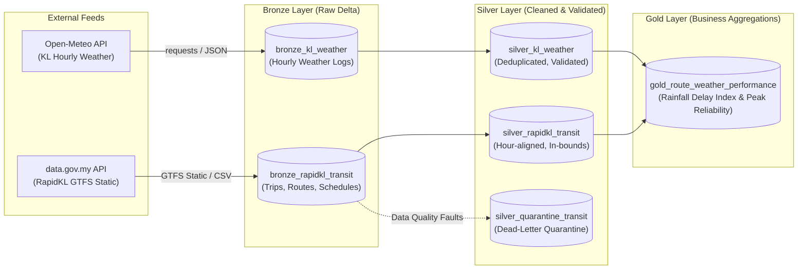

# Klang Valley Transit & Weather Data Pipeline

[](#)
[-00ADD8?logo=apachespark&logoColor=white)](#)
[](#)
[](#)

A production-grade Databricks PySpark pipeline built on the **Medallion Architecture (Delta Lake)** that ingests, cleans, and joins **RapidKL public bus transit feeds** with **Kuala Lumpur meteorological data** to measure route performance, rainfall delay indices, and peak hour reliability metrics.

---

## Architecture & Medallion Pattern



---

## Step 1: Bronze Layer (Raw Ingestion)

The **Bronze Layer** ingests raw source feeds with minimal transformations into **Delta Lake**, strictly capturing raw fidelity while appending pipeline audit metadata.

### 1. Kuala Lumpur Weather Feed (`bronze_kl_weather`)
* **Source:** Open-Meteo Historical Archive / Forecast API
* **Coordinates:** Lat `3.1390`, Lon `101.6869` (Kuala Lumpur, Malaysia)
* **Timezone:** `Asia/Kuala_Lumpur` (UTC+8)
* **Variables:** `temperature_2m`, `precipitation` (mm), `rain` (mm), `weather_code`, `relative_humidity_2m`, `wind_speed_10m`
* **Format:** Unpacked from parallel hourly JSON arrays into PySpark DataFrame with timestamp casting and audit fields (`_ingested_at`, `_source_api`).

### 2. RapidKL Bus Transit Feed (`bronze_rapidkl_transit`)
* **Source:** `https://api.data.gov.my/gtfs-static/prasarana?category=rapid-bus-kl`
* **Entities Ingested:**
  - `routes.txt`: Bus route IDs, names, and transit types (~138 routes).
  - `trips.txt`: Scheduled trip identifiers, direction, and shape bindings (~2,098 trips).
  - `stops.txt`: Stop names, unique stop IDs, and coordinates (~4,069 stops).
  - `stop_times.txt`: Scheduled arrival/departure sequences (~88,106 scheduled stop events).
* **Format:** Linked and ingested into Delta Lake table with lineage columns (`_ingested_at`, `_feed_category`, `_source`).

---

## Step 2: Silver Layer (Data Cleaning & Validation)

The **Silver Layer** enforces schemas, performs data deduplication, applies geospatial boundary filtering, handles GTFS timestamp anomalies, and implements an automated **quarantine dead-letter pattern**.

### 1. Filtering & Deduplication
* **Weather:** Deduplicated on `weather_timestamp`, keeping the latest ingested observation via windowed ranking (`row_number()`).
* **Transit:** Deduplicated on composite key `(trip_id, stop_id, stop_sequence)`, keeping the latest record.

### 2. Klang Valley Bounding Box Validation
Bus stops located outside Greater Kuala Lumpur / Klang Valley are filtered using the bounding envelope:
* **Latitude:** `2.8°` to `3.5° N`
* **Longitude:** `101.3°` to `101.9° E`

### 3. Timestamp Alignment for Weather Joining
* GTFS `stop_times.txt` formats scheduled arrivals/departures as strings (e.g. `08:30:00`).
* **Midnight Rollover Handling:** GTFS allows timestamps `> 24:00:00` (e.g. `25:15:00` for 1:15 AM next service day). These are normalized with modulo-24.
* **Hour Rounding:** Timestamps are rounded to the nearest integer hour `(0–23)` creating the `scheduled_hour_aligned` column, enabling direct analytical joins with Open-Meteo hourly weather observations.

### 4. Data Quality Quarantine (`silver_quarantine_transit`)
Records that violate data contracts are split from the main pipeline and written to `silver_quarantine_transit` with explicit `_quarantine_reason` tags:
* Missing or empty `route_id` (`MISSING_ROUTE_ID`)
* Negative vehicle speeds or invalid stop sequences (`NEGATIVE_SPEED_OR_SEQUENCE`)
* Coordinates outside the Klang Valley bounding box (`OUT_OF_BOUNDS_COORDINATES`)

---

## Step 3: Gold Layer (Business Aggregations)

The **Gold Layer** transforms cleaned Silver tables into an analytics-ready business data product that quantifies the impact of tropical precipitation and rush-hour congestion across the RapidKL bus network.

### 1. Temporal Join on Hourly Timestamp
* Joins `silver_rapidkl_transit` and `silver_kl_weather` where `scheduled_hour_aligned == HOUR(weather_timestamp)`.
* Binds each scheduled transit stop event with exact meteorological conditions (rainfall intensity, temperature, humidity).

### 2. Hop-by-Hop Transit Distance & Speeds
* Calculates spherical distance between consecutive bus stops using the **Haversine formula**.
* Computes travel time durations from GTFS departure times and derives operating speed (`km/h`).

### 3. Key Business Performance Indicators
* **Rainfall Delay Index:** Evaluates route operating speeds during heavy downpours (`precipitation > 5.0 mm/hr`) vs. clear weather baselines (`precipitation <= 0.5 mm/hr`). Computes absolute speed drop (`km/h`), percentage speed drop (`%`), and travel delay multiplier.
* **Peak Hour Reliability:** Evaluates route operating speeds during Morning Peak (`7:00 AM – 9:59 AM`) and Evening Peak (`5:00 PM – 7:59 PM`) relative to off-peak periods, generating a normalized peak reliability score.

### 4. Output Managed Delta Table
* Clean aggregate metrics are saved to `gold_route_weather_performance`.

---

## Repository Structure

```
Klang Valley Transit & Weather Data Pipeline/
├── notebooks/
│   ├── 01_bronze_ingestion.py         # Bronze Raw Ingestion Notebook
│   ├── 02_silver_transformation.py    # Silver Cleaning, Validation & Quarantine Notebook
│   └── 03_gold_aggregations.py        # Gold Business Aggregations & Analytics Notebook
├── src/
│   ├── config.py                      # Centralized coordinates, bounding box & table names
│   ├── utils/
│   │   ├── __init__.py
│   │   └── logger.py                  # Structured logging utility
│   ├── ingestion/
│   │   ├── __init__.py
│   │   ├── weather_ingestion.py       # Open-Meteo fetch & PySpark parser
│   │   └── transit_ingestion.py       # data.gov.my GTFS downloader & builder
│   └── transformation/
│       ├── __init__.py
│       ├── silver_weather.py          # Weather deduplication & bounds validation
│       ├── silver_transit.py          # Transit deduplication, bounding box & quarantine
│       └── gold_aggregations.py       # Hop speeds, hourly joins, Delay Index & KPIs
├── scripts/
│   └── fetch_raw_samples.py           # Local script to fetch & cache raw data samples
├── tests/
│   ├── __init__.py
│   ├── test_raw_ingestion.py          # Bronze ingestion unit & schema validation tests
│   └── test_gold_aggregations.py      # Gold KPIs, Haversine & Delay Index unit tests
├── data/
│   └── raw/                           # Downloaded sample data (JSON & GTFS CSVs)
│       ├── weather/
│       └── gtfs/
├── requirements.txt                   # Pipeline dependencies
├── .gitignore                         # Delta logs, checkpoints, cache ignores
└── README.md                          # Pipeline documentation
```

---

## How to Run on Databricks

### 1. Link Repo via Databricks Repos / Git Folders
1. In your Databricks workspace sidebar, open **Workspace → Repos (or Git Folders)**.
2. Click **Add Repo** and paste your GitHub repository URL:
   `https://github.com/ReapZaysh/klang-valley-transit-weather-pipeline.git`
3. All notebooks and `src/` modular code will be directly available in your workspace.

### 2. Run Bronze Ingestion Notebook
1. Open `notebooks/01_bronze_ingestion`.
2. Configure parameters via the interactive widgets (e.g. `start_date`, `end_date`, `transit_category`).
3. Click **Run All** to populate `bronze_kl_weather` and `bronze_rapidkl_transit`.

### 3. Run Silver Transformation Notebook
1. Open `notebooks/02_silver_transformation`.
2. Click **Run All** to execute deduplication, bounding box validation, and quarantine routing.
3. The notebook writes clean data to `silver_kl_weather` and `silver_rapidkl_transit`, while routing bad records to `silver_quarantine_transit`.

### 4. Run Gold Aggregations Notebook
1. Open `notebooks/03_gold_aggregations`.
2. Click **Run All** to calculate hop distances, temporal weather joins, Rainfall Delay Indices, and peak reliability metrics.
3. The notebook persists `gold_route_weather_performance` and runs analytical queries.

---

## Data Dictionary

### Bronze Tables
* `bronze_kl_weather`: Raw hourly Open-Meteo weather logs (`observation_time`, `temperature_2m`, `precipitation`, `rain`, etc.).
* `bronze_rapidkl_transit`: Raw linked GTFS feeds (`route_id`, `trip_id`, `stop_id`, `stop_name`, `stop_lat`, `stop_lon`, `arrival_time`, etc.).

### Silver Tables
* `silver_kl_weather`: Cleaned, validated, deduplicated hourly weather readings within Malaysia meteorological thresholds.
* `silver_rapidkl_transit`: Cleaned transit schedules with validated Klang Valley GPS bounds and `scheduled_hour_aligned`.
* `silver_quarantine_transit`: Invalid/corrupted records separated with diagnostic column `_quarantine_reason` and `_quarantined_at`.

### Gold Table
* `gold_route_weather_performance`:
  - `route_id`, `route_short_name`, `route_long_name`, `route_type`: Route identifiers.
  - `total_trips_analyzed`, `total_stops_analyzed`: Schedule volume indicators.
  - `avg_scheduled_speed_kmh`: Baseline scheduled operating speed.
  - `avg_speed_clear_kmh`: Operating speed during clear weather (`precipitation <= 0.5 mm`).
  - `avg_speed_rain_kmh`: Operating speed during any rainfall (`precipitation > 0.5 mm`).
  - `avg_speed_heavy_rain_kmh`: Operating speed during heavy downpours (`precipitation > 5.0 mm`).
  - `speed_drop_heavy_rain_kmh`: Absolute speed reduction during heavy downpours.
  - `speed_drop_heavy_rain_pct`: Percentage speed reduction during heavy downpours.
  - `rainfall_delay_index`: Travel time multiplier under heavy rain vs. clear weather.
  - `avg_speed_morning_peak_kmh`: Speed during morning rush hour (7–9 AM).
  - `avg_speed_evening_peak_kmh`: Speed during evening rush hour (5–7 PM).
  - `avg_speed_off_peak_kmh`: Speed during off-peak hours.
  - `morning_peak_reliability_pct`, `evening_peak_reliability_pct`: Speed retention percentages during rush hours.
  - `overall_peak_reliability_score`: Consolidated peak reliability score.
  - `_layer`, `_gold_processed_at`: Pipeline governance metadata.
